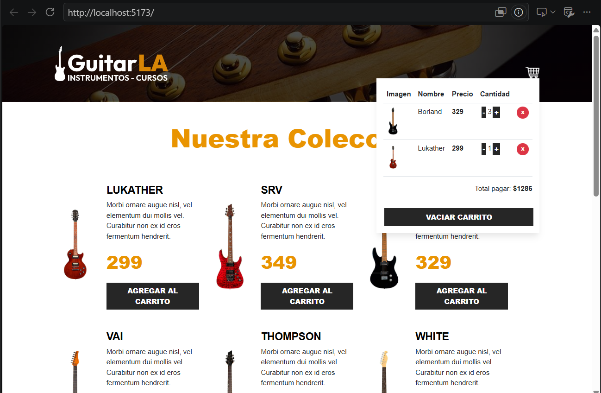

# GuitarsLA-TS

> Aplicación web académica de una tienda de guitarras, desarrollada con React y TypeScript.

## Índice

1. [Visión general](#visión-general)
   - [Problema que resuelve](#problema-que-resuelve)
   - [Capturas de pantalla](#capturas-de-pantalla)
   - [Demo](#demo)
2. [Ficha técnica](#ficha-técnica)
   - [Lenguajes y versiones](#lenguajes-y-versiones)
   - [Nivel de tipado](#nivel-de-tipado)
   - [Framework, librerías y dependencias](#framework-librerías-y-dependencias)
   - [Entorno de desarrollo](#entorno-de-desarrollo)
3. [Arquitectura](#arquitectura)
   - [Organización general](#organización-general)
   - [Responsabilidad de cada carpeta](#responsabilidad-de-cada-carpeta)
4. [Hooks nativos](#hooks-nativos)
5. [Custom Hook: `useCart`](#custom-hook-usecart)
   - [Responsabilidades](#responsabilidades)
   - [Valores que expone](#valores-que-expone)

---

## Visión general

GuitarsLA-TS es una aplicación web desarrollada con React y TypeScript que simula una tienda de guitarras. Permite visualizar un catálogo, agregar guitarras al carrito, modificar sus cantidades y conservar la información incluso después de cerrar o actualizar el navegador mediante **LocalStorage**.

El proyecto fue desarrollado con fines académicos para aplicar conceptos del ecosistema de React, incluyendo Hooks, componentes, Custom Hooks, manejo de estado y persistencia de datos.

### Problema que resuelve

En una tienda en línea es necesario que el usuario pueda:

- Consultar un catálogo de productos.
- Agregar artículos a un carrito.
- Modificar cantidades y eliminar productos.
- Mantener el carrito guardado aunque cierre la página.

La aplicación cubre estas necesidades mediante una arquitectura basada en React y almacenamiento persistente con LocalStorage.

### Capturas de pantalla



La evidencia contempla la pantalla principal, el carrito de compras y productos guardados en LocalStorage.

### Demo

Actualmente el proyecto no cuenta con un despliegue en producción. Si se publica posteriormente, se puede agregar aquí el enlace:

```text
https://mi-proyecto.vercel.app
```

---

## Ficha técnica

### Lenguajes y versiones

| Tecnología | Versión |
| --- | --- |
| TypeScript | 6.0.2 |
| React | 19.2.8 |
| React DOM | 19.2.8 |
| JavaScript | ES2023 (generado por TypeScript) |

### Nivel de tipado

El proyecto utiliza **TypeScript** para definir tipos de props, objetos, arreglos, funciones y datos del carrito. Esto reduce errores durante el desarrollo y mejora el autocompletado del editor.

### Framework, librerías y dependencias

Se utilizan React y React DOM. No se incorporaron librerías externas para el manejo de estado, como Redux o Zustand, porque el tamaño del proyecto no lo requiere. Los estilos se implementaron con archivos CSS incluidos en el proyecto.

| Producción | Desarrollo |
| --- | --- |
| React | TypeScript |
| React DOM | Vite |
|  | ESLint |
|  | `@vitejs/plugin-react` |
|  | `typescript-eslint` |
|  | `eslint-plugin-react-hooks` |

Estas herramientas permiten desarrollar una aplicación moderna, rápida y con validación de buenas prácticas.

### Entorno de desarrollo

| Herramienta | Uso |
| --- | --- |
| Vite 8 | Bundler y servidor de desarrollo |
| npm | Gestor de paquetes |

---

## Arquitectura

La aplicación sigue una arquitectura de componentes reutilizables. La lógica de negocio se separa de la interfaz gráfica mediante un **Custom Hook**, lo que facilita el mantenimiento y la reutilización de la lógica del carrito.

### Organización general

```text
src/
├── components/
│   ├── Guitar.tsx
│   └── Header.tsx
├── hooks/
│   └── useCart.ts
├── data/
│   └── db.ts
├── App.tsx
├── main.tsx
└── types.d.ts
```

### Responsabilidad de cada carpeta

| Ruta | Responsabilidad |
| --- | --- |
| `components` | Componentes visuales de la aplicación. |
| `hooks` | Lógica reutilizable del carrito de compras. |
| `data` | Datos locales con la información de las guitarras. |
| `types.d.ts` | Tipos utilizados dentro del proyecto. |

---

## Hooks nativos

| Hook | Uso en el proyecto |
| --- | --- |
| `useState` | Administra el carrito, las cantidades y las actualizaciones del estado. React vuelve a renderizar la interfaz cuando cambia la información. |
| `useEffect` | Sincroniza el carrito con LocalStorage cuando cambia, para conservar los productos entre visitas. |
| `useMemo` | Optimiza cálculos derivados del carrito, como verificar si está vacío y calcular el total. |
| `useRef` | No fue necesario; la aplicación no manipula directamente elementos del DOM. |
| `useCallback` | No fue necesario; las funciones no generan problemas de renderizado que justifiquen su uso. |
| `useContext` | No se utilizó; el estado se administra mediante un Custom Hook. |
| `useReducer` | No fue necesario porque la lógica puede manejarse correctamente con `useState`. |

---

## Custom Hook: `useCart`

El Hook personalizado `useCart()` encapsula la lógica relacionada con el carrito. Así, los componentes consumen la información sin depender de los detalles de su implementación.

### Responsabilidades

- Agregar y eliminar productos.
- Incrementar y disminuir cantidades.
- Vaciar el carrito y calcular el total.
- Verificar si el carrito está vacío.
- Recuperar los datos desde LocalStorage y guardarlos automáticamente.

### Valores que expone

Entre los principales valores retornados por el Hook se encuentran:

| Estado o función | Descripción |
| --- | --- |
| `cart` | Productos y cantidades del carrito. |
| `data` | Datos del catálogo. |
| `addToCart()` | Agrega un producto. |
| `increaseQuantity()` | Incrementa la cantidad de un producto. |
| `decreaseQuantity()` | Disminuye la cantidad de un producto. |
| `removeFromCart()` | Elimina un producto. |
| `clearCart()` | Vacía el carrito. |
| `isEmpty` | Indica si el carrito está vacío. |
| `cartTotal` | Total de la compra. |

Esta arquitectura mantiene separados los componentes visuales y la lógica de negocio.